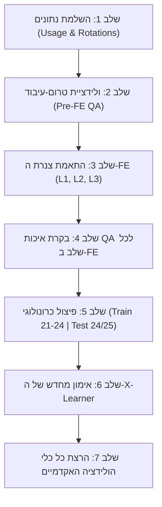

# תוכנית עבודה: הרחבה רב-עונתית ומבחן זמן עיוור (Multi-Season Action Plan)

> **מטרה מדעית (סעיף 5 בדרישות ד"ר רחל שפירא):**  
> מעבר מאימון ובדיקה על עונה בודדת (2024/25) למבחן הזהב של הכללה בזמן (**External Temporal Generalization**).  
> אימון המודלים הסיבתיים על מספר עונות היסטוריות מלאות (2021/22, 2022/23, 2023/24) ובדיקה עיוורת לחלוטין על עונת 2024/25 שלא נראתה באימון כלל.

---

## 🗺️ פירוט השלבים ומשימות הביצוע

---

### שלב 1: השלמת נתוני רקע (Lookups & Rotations)
- [x] **1.1 משיכת שחקני מפתח (High Usage Stars):**
  - התאמת והרצת `scripts/fetch_high_usage_players.py` עבור עונות `2021-22`, `2022-23`, `2023-24`.
  - שמירת קבצי ה-Lookup ב-`data/lookup/high_usage_players_{season}.csv`.
- [x] **1.2 משיכת נתוני רוטציות (Rotations Fetcher):**
  - התאמת `scripts/fetch_rotations.py` למשיכה מרובת עונות עם מנגנון שמירת מצב והתאוששות משגיאות (Checkpointing/Resume).
  - שמירת קבצי הרוטציות: `rotations_2021_22.csv`, `rotations_2022_23.csv`, `rotations_2023_24.csv` ב-`data/pureData/`.

---

### שלב 2: התאמת סקריפטי טרום-עיבוד וולידציה (`scripts/test_and_val/`)
- [x] **2.1 הסרת Hardcoding:**
  - עדכון `scripts/test_and_val/data_validation.py` ו-`check_data_health.py` לקבלת שם עונה כארגומנט דינמי.
  - עדכון כל 8 סקריפטי הבדיקות והראנר הראשי `run_all_tests.py` לתמיכה מלאה בדינמיות עונות, דוחות QA מסודרים ב-`reports/qa_reports/`, ותאימות לאחור מלאה.
- [x] **2.2 הרצת סוויטת הבדיקות המלאה:**
  - הרצת `scripts/test_and_val/run_all_tests.py` על כל 4 קבצי העונות הגולמיים (`data/pureData/season_*.csv`).
  - וידוא עמידה ב-NBA Benchmarks, היעדר שגיאות שעון ואפס NaNs במזהי מפתח. כל הפלטים נשמרו ב-`reports/qa_reports/`.

---

### שלב 3: התאמת סקריפטי ה-Feature Engineering (L1, L2, L3)
- [x] **3.1 שלב L1 Base Timeline (`scripts/feature_engineering/01_build_level1_base.py`):**
  - תמיכה בהעברת עונה כפרמטר (`--season`).
  - טעינת קובץ הרוטציה התואם לאותה עונה (עם שימוש ב-Fallback inference במקרה של חוסר).
  - פליטת קבצי ביניים לפי עונה: `data/interim/level1_base_{season}.csv` ותאימות לאחור.
- [x] **3.2 שלב L2 Momentum & Fatigue (`scripts/feature_engineering/02_build_level2_momentum.py`):**
  - טעינת שחקני ה-Usage המתאימים ספציפית לעונה המעובדת מ-`data/lookup/high_usage_players_{season}.csv`.
  - פליטת קבצי ביניים: `data/interim/level2_features_{season}.csv`.
- [x] **3.3 שלב L3 Causal Labels & Targets (`scripts/feature_engineering/03_build_level3_labels.py`):**
  - חישוב חלונות זמן (90s / 180s) וסינון זליגת Lookahead לכל עונה.
  - פליטת קבצי ביניים: `data/interim/level3_labels_{season}.csv`.

---

### שלב 4: בקרת איכות (QA) לכל שלב ב-FE
- [ ] **4.1 בדיקות איכות L1–L3:**
  - הרצת `check_level1_quality.py`, `check_level2_quality.py`, `check_level3_quality.py` על כל עונה בנפרד.
- [ ] **4.2 וידוא שלמות מתודולוגית:**
  - אימות שאין NaNs בתכונות קריטיות (עייפות, מומנטום, חמישיות).
  - אימות שחלוקת ה-Right-Censoring ביעדי 90s ו-180s מדויקת.

---

### שלב 5: פיצול נתונים רב-עונתי כרונולוגי (ML Splits)
- [ ] **5.1 התאמת `models/prepare_ml_splits.py`:**
  - שינוי אופן החלוקה: במקום 70/15/15 שרירותי, חלוקה לפי עונות.
  - **Train Set:** איחוד עונות 2021/22, 2022/23, 2023/24 (~3,700 משחקים, כ-1.5 מיליון אירועים).
  - **Validation Set:** מדגם משחקים מתוך עונות האימון (לכיול היפר-פרמטרים).
  - **Test Set (עיוור לחלוטין):** עונת 2024/25 בשלמותה (~1,230 משחקים, כ-460k אירועים).
- [ ] **5.2 בדיקת מניעת דליפה מוחלטת:**
  - אימות שאין שום חפיפת משחקים בין Train ל-Test ($0\%$ Game Leakage).
  - שמירת התוצרים בפורמט Parquet מהיר: `data/processed/train.parquet`, `test.parquet`.

---

### שלב 6: אימון מחדש של ה-X-Learner
- [ ] **6.1 הרצת `models/06_causal_x_learner.py`:**
  - אימון על ה-Train המורחב (1.5M שורות) עם ה-`StratifiedGroupKFold` המעודכן (5 קיפולים ברמת משחק).
  - הפקת מודלי ה-Propensity, Outcome ושאריות ה-CATE.
- [ ] **6.2 שמירת המודלים המעודכנים:**
  - שמירה ב-`models/saved_models/` עבור כל 4 יעדי הפסק זמן.

---

### שלב 7: הרצת כל כלי הולידציה האקדמיים על ה-Test העיוור (2024/25)
- [ ] **7.1 בדיקת Common Support & Overlap (`models/evaluate_overlap_balance.py`):**
  - אימות הנחת ה-Positivity והפקת גרפי חפיפה ו-Love Plots מעודכנים.
- [ ] **7.2 בדיקת Decile Uplift (`models/evaluate_cate_uplift.py`):**
  - הוכחת מונוטוניות מחוץ למדגם על עונה עתידית מלאה (גרף עשירונים ו-JSON).
- [ ] **7.3 בנצ'מרק מתחרה DR-Learner (`models/train_dr_learner_benchmark.py`):**
  - אימון EconML DRLearner על ה-Train הרב-עונתי והשוואת קורלציית דירוג ואחוזי הסכמה ב-Test 2024/25.

---

### שלב 8: תיעוד סופי וסגירת הדרישות למאמר
- [ ] **8.1 עדכון `docs/dr_shapira_action_items.md`:**
  - סיכום תוצאות המבחן העיוור הרב-עונתי (אימות סעיף 5).
- [ ] **8.2 ארכוב גרפים ודוחות רשמיים:**
  - העברת כל התוצרים הסופיים לתיקיית `reports/paper_preparation/`.
- [ ] **8.3 Git Commit & Push:**
  - שמירה ודחיפה של כל הקוד והדוקומנטציה לענף `paper-preparation`.
